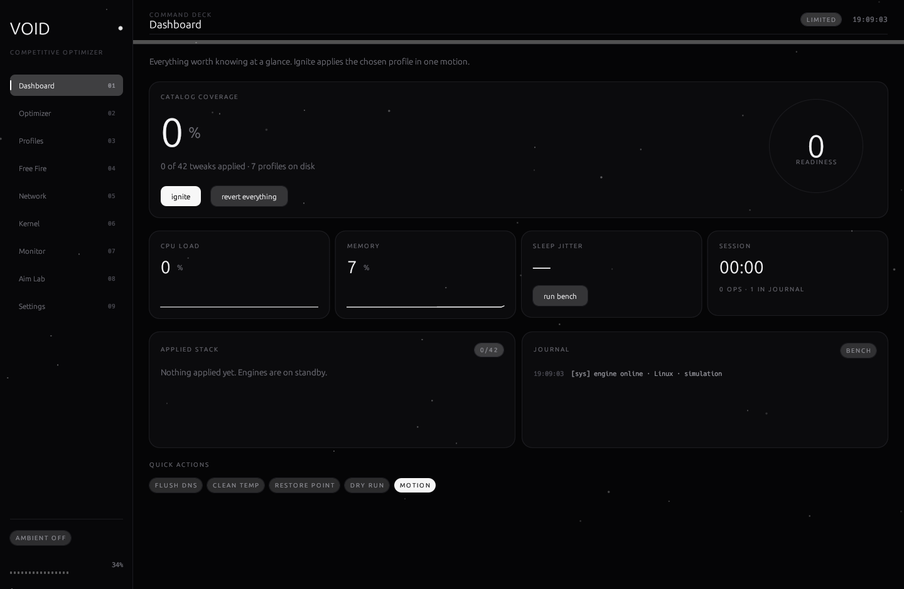
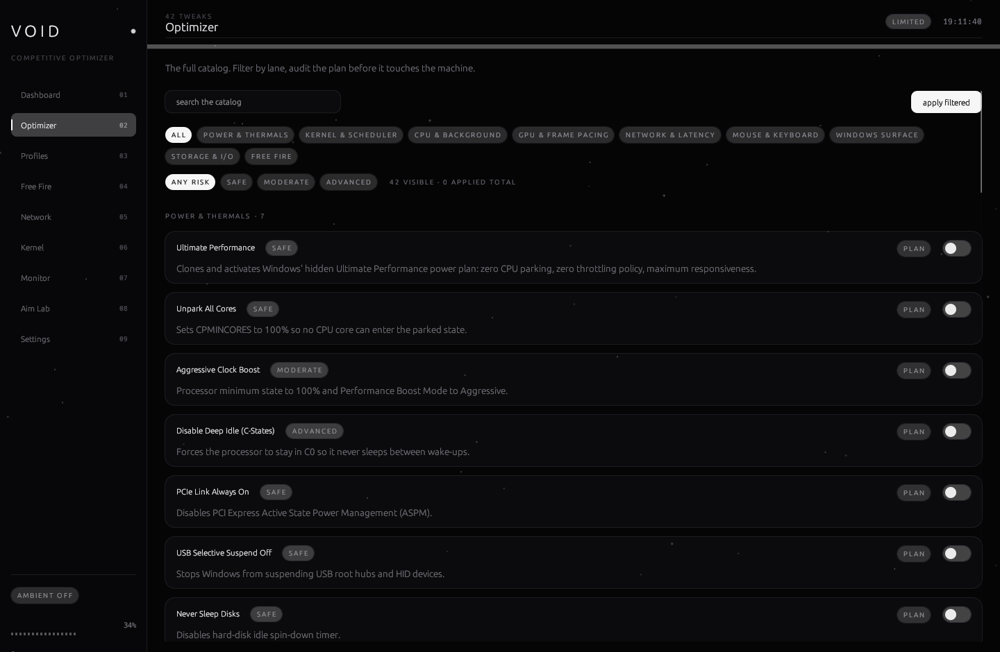
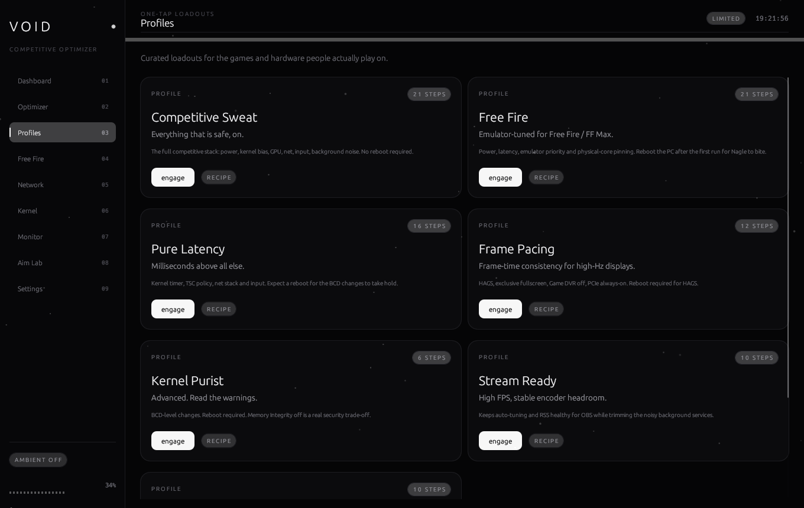
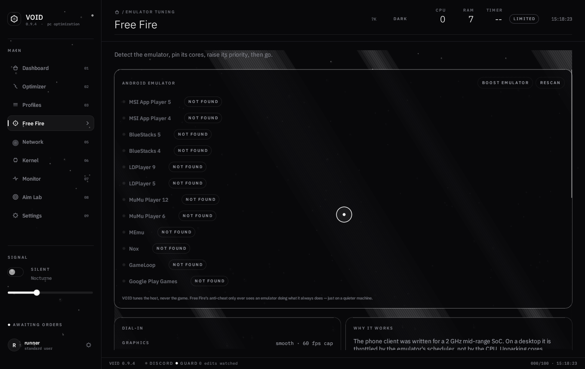
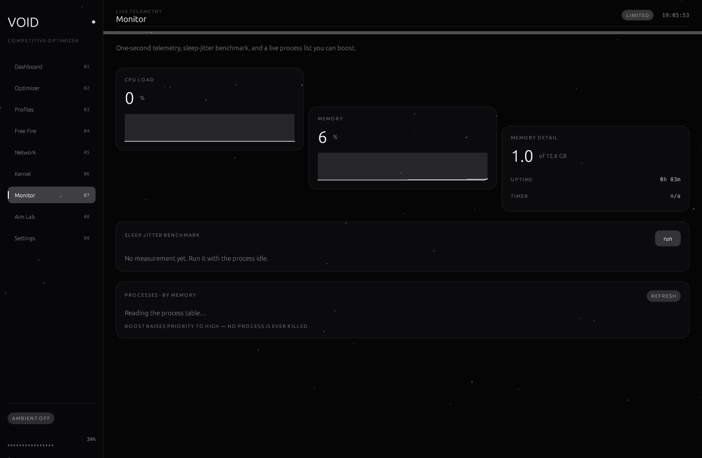
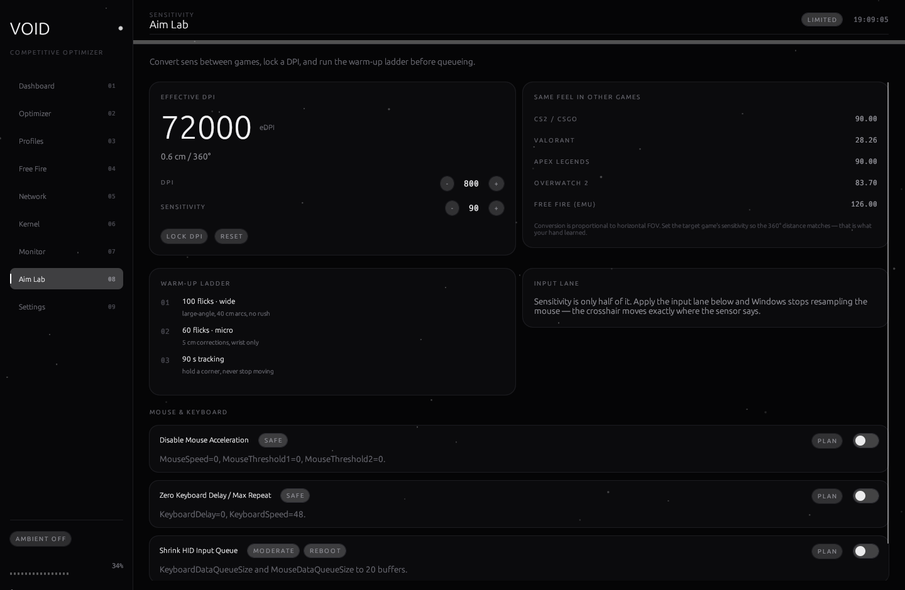
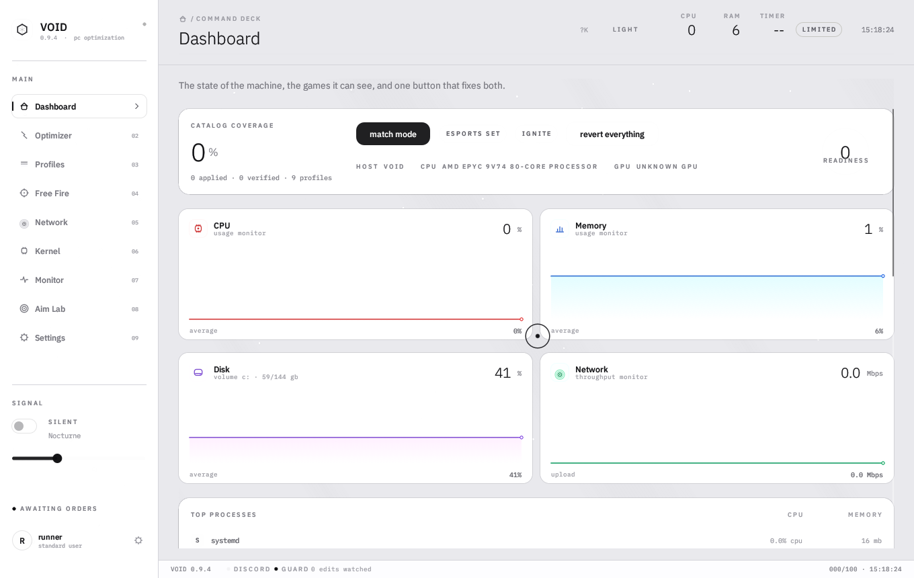

<div align="center">

# V O I D

**A luxury-grade competitive gaming optimizer.**
A native desktop app — one window, drawn on the GPU. Engine in-process, every lever documented, every change reversible.

`v0.7.0` · native UI · 8 ms cold start · verified tweaks · Free Fire / FF Max · monochrome · ambient audio

[](https://github.com/husainprime20/VOID-OPTIMIZER/actions/workflows/build.yml)
[](https://github.com/husainprime20/VOID-OPTIMIZER/releases/latest)

</div>

---

## Download

**[⬇ VOID.exe — latest](https://github.com/husainprime20/VOID-OPTIMIZER/releases/latest/download/VOID.exe)** · Windows 10/11 x64
&nbsp;·&nbsp; [portable zip with `void-cli.exe` + checksums](https://github.com/husainprime20/VOID-OPTIMIZER/releases/latest)

```
1. download VOID.exe
2. double-click it          → Windows asks for Administrator once (the tweaks need it)
3. the window opens         → press IGNITE, or open Profiles and engage one
```

* **No console window.** The binary is built for the Windows GUI subsystem and every helper
  process is spawned with `CREATE_NO_WINDOW`, so nothing black flashes behind the app.
* **No browser, no webview, no localhost.** The UI is drawn by `egui` (OpenGL 3.3) inside the
  same process as the engine. There is no HTTP bridge, which means the old
  *"engine offline — could not reach the VOID engine API"* state is **structurally impossible**.
* Static CRT — no Visual C++ redistributable.
* Not code-signed: SmartScreen asks once → **More info** → **Run anyway**.
* Every release is compiled *and executed* by GitHub Actions on `windows-latest`
  (`--version`, full catalog dump, `VOID.exe --selftest`) before publishing.

---

---

## Screenshots

Rendered from the real binary, head-lessly, by CI on every push (branch `void-preview`):

| | |
|---|---|
|  |  |
|  |  |
|  |  |
|  |  |
|  |  |

## What VOID is

VOID is a **desktop performance toolkit for people who care about the last 3 milliseconds**.
It modifies *Windows* — power, kernel timers, scheduler bias, GPU frame path, TCP latency,
input stack — through the official `powercfg` / `bcdedit` / `reg` / `netsh` / `sc` / `fsutil`
interfaces, and it shows you exactly which command it will run *before* it runs it.

It does **not** touch game files, game memory, or anti-cheat. It never injects, never hooks,
never patches a running game. Everything it changes is a documented Windows setting with a
documented way back.

---

## Nine views

| view | what it does |
|---|---|
| **01 Dashboard** | catalog coverage ring, CPU/RAM sparklines, applied stack, live journal, quick actions |
| **02 Optimizer** | all 85 tweaks, searchable, filterable by lane and risk; every entry shows its exact plan |
| **03 Profiles** | 7 curated loadouts (competitive, free fire, latency, gpu, kernel, stream, bench) |
| **04 Free Fire** | detects BlueStacks / LDPlayer / MuMu / MEmu / Nox / GameLoop, launches and boosts them |
| **05 Network** | Nagle off, MMCSS Games task, throttling index, DNS flush, queue-shape sketch |
| **06 Kernel** | timer resolution, TSC sync, HAGS, `Win32PrioritySeparation`, VBS, core parking |
| **07 Monitor** | 1-second telemetry, sleep-jitter benchmark (avg/p50/p95/max/score + delta vs previous run), process list with boost |
| **01 Dashboard** | also: **game watch** — recognises running games from the process table and offers the matching loadout |
| **08 Aim Lab** | eDPI + cm/360° calculator, per-game sensitivity equivalents, warm-up ladder |
| **09 Settings** | sound, motion, safety rails, live engine report (CPU, GPU, admin, timer, power plan) |

### What's new in 0.7.0

* **Discord account authorization.** The real flow, end to end, with no backend and no
  dependency: VOID asks the local Discord client for consent (`AUTHORIZE`, scope `identify`),
  takes the one-time code, exchanges it for a token **straight to `discord.com` over
  WinHTTP**, and reads `/api/users/@me` — so the app knows your name, id and avatar hash.
  The account shows as a drawn monogram, a tag in the status bar, and an *open profile* link.
  Your app's client secret is pasted into Settings and stays on this machine; **no secret
  ships inside the binary**, which is the only defensible way to ship OAuth in a desktop app.
* **WinHTTP, natively.** `platform::https` is ~120 lines of Win32: `WinHttpOpen` →
  `WinHttpConnect` → `WinHttpOpenRequest` → `SendRequest` → `ReadData`, with timeouts and
  the system TLS stack. No TLS crate, no `curl`, no PowerShell, no console flash.
* **Unlink and replace.** *Unlink* drops the session, *replace secret* opens the field again,
  and the consent dialog is re-opened per request — Discord remembers a granted app.
* **Link from the palette.** `Ctrl/⌘+K` → "Link Discord account".

### What's new in 0.6.0

* **A mark.** `docs/branding/VOID-icon-512.png` is the brand: a single broken ring around a
  still point, 512×512 with alpha, ready to drop into the Discord developer portal as a Rich
  Presence asset. The same geometry ships inside the app — the window/taskbar icon is
  embedded as raw RGBA (`assets/icon64.rgba`, no image decoder linked) and `assets/void.ico`
  is compiled into `VOID.exe` with a version block by `build.rs`.
* **Rain.** Three parallax bands of streaks fall behind the deck — fixed geometry per drop,
  cosine drift, edge fade, no allocations. Toggleable, and it respects reduced motion.
* **Discord link.** The RPC client gained a reply thread, so VOID can ask the Discord client
  `GET_CURRENT_USER` and show **who is signed in**: your tag lands in the status bar and in a
  new Discord card (connection state, account, client id with copy, reconnect). No SDK, no
  OAuth secret in the binary — the app authorises once inside Discord.
* **Status bar.** A real application rail: build, discord, account, guard and live score.
* **Auto-loadout.** With it on, VOID watches the process table and arms a title's tuning set
  the moment the game launches — once per title, never mid-job.
* **Surface depth.** Cards carry a one-pixel top highlight, the rail gained section labels,
  and the section heads read like a product, not a settings page.

### What's new in 0.5.0

* **Two themes, one ramp.** **Obsidian** (near-black) and **Porcelain** (light) are the same
  drawing inverted — same alphas, same hairlines, same type. Flip it from the top bar, the
  settings card or the palette; the choice persists.
* **Discord rich presence, native.** VOID talks to the Discord client directly over
  `\\.\pipe\discord-ipc-N` — a hand-rolled framed-JSON client on a background thread, in
  about a hundred lines with no SDK and no dependency. It shows your tuned count, verified
  count, VOID score, the view you are on and the session clock, plus a link back to this
  repo. App id `1571961942044713070`.
* **Pre-flight.** Seven checks — elevation, power plan, kernel timer, catalog coverage,
  sleep jitter, handshake RTT, emulator presence — each derived from a measurement, with a
  **fix the gaps** button that applies the profile which closes whatever is open.
* **Void Guard.** Every twenty seconds VOID reads its applied changes back out of Windows.
  Anything that drifted is re-asserted without asking. A game overlay, a driver updater or
  a Windows refresh can silently undo a tweak; the guard puts it back.
* **Command palette.** `Ctrl/⌘+K` reaches every view, every action and every tweak in one
  box. `Ctrl/⌘+1…9` jumps between views. `Esc` closes everything.
* **CPU attribution.** The monitor diffs `GetProcessTimes` per process between two samples, so
  it can **name the process that ate the frame** — kernel + user time, ranked, with a one-click
  boost for the top consumer. Task Manager shows you a percentage; VOID tells you who.
* **Diagnostics export.** One markdown file with the machine, the score, the checklist, the
  applied catalog with the reason for each entry, and the tail of the journal — written to
  the data directory from the settings card or the palette.
* **Still monochrome, still native, still 4.5 MB.** No new dependencies; the presence client
  and the pipe protocol are in-tree.

### What's new in 0.4.0

* **43 more optimizations — 85 in total.** New lanes and entries that were not in 0.3.0:
  QoS reserved bandwidth, `NetworkThrottlingIndex`, the ephemeral port pool, IPv6 stack,
  network discovery, notification silence, offline start search, WER, Store auto-updates,
  AutoPlay, widgets feeds, Edge preload, lock-screen rotation, Copilot, taskbar chat, pen
  services, static screen saver, forced Game Mode, startup stagger, Wi-Fi power save,
  Wi-Fi adapter online, aggressive core boost, uncapped usable cores, longer TDR watchdog,
  MMCSS Games task, global timer resolution, GPU preference per game exe, mouse/keyboard
  queue sizes, audio ducking, MMCSS audio task, initial RTO, LLMNR, Teredo, WDDM coalescing,
  Spectre/Meltdown override, hibernate file, delivery optimization and system cache tuning.
  Every one of them is reversible and read back from Windows after it is written.
* **MSI App Player 5 and eleven other emulators.** The emulator table is now a registry-first
  probe: MSI App Player 5 (`BlueStacks_msi5`) and 4 (`BlueStacks_msi2`), BlueStacks 5 / 4,
  LDPlayer 9 / 5, MuMu 12 / 6, MEmu, Nox, GameLoop and Google Play Games. VOID finds the
  install from the registry, falls back to the known install paths, and can launch, detect
  and boost whichever instance is running — including the `Launcher` sub-shell MSI ships.
* **Net Lab.** A new measurement nobody else ships in an optimizer: four TCP handshakes to
  `1.1.1.1`, Steam, Riot, Epic and Garena, reported as average RTT, jitter and loss per
  endpoint. It measures the same path a game client walks, needs no driver and no elevation.
* **VOID Score.** One number for how ready the machine is to compete, built only from
  measurements that actually succeeded: applied share of the catalog, the kernel timer
  resolution, sleep jitter from the benchmark, and handshake RTT from Net Lab. Missing
  measurements are dropped, never scored as zero.
* **Match Mode.** One press runs the whole routine in sequence — the esports set, then Net
  Lab, then a fresh benchmark — with the job strip reporting each step and the chain
  continuing automatically when the previous job finishes.
* **Bench history.** The last twelve benchmark scores persist to `data_dir/bench.log` and are
  drawn as a trend sparkline, so you can see whether a session actually helped.
* **Trauma.** A fourth ambient bed built around a 41 Hz sub with a slow glide thump, a
  1.6-second fade-in, and an intensity control that scales pulse depth and bell density.
* **More motion, still monochrome.** The readiness ring now eases instead of jumping and
  carries an ignite scanline while a job runs; the rail indicator glides between items;
  meters ease toward their values; toasts slide in and carry a life hairline; the job strip
  has a travelling shimmer.

### What's new in 0.3.0

* **It opens instantly.** The window used to wait on four PowerShell CIM queries (OS, CPU,
  GPU, admin) before it could draw. All of that now comes from the registry, the process
  token and `powrprof` — **`boot_ms` is 8 ms** for the whole engine bring-up, measured on
  the Windows build in CI. The only thing you wait for is the UAC prompt.
* **The options actually run.** Every change happens on a worker thread with a progress
  strip (`12/42 · registry value …`), so the window never freezes, and every registry write
  is **read back from Windows** afterwards. A row shows `live` when the machine really holds
  the value and `drift` when something else changed it behind VOID's back.
* **Dry run is gone.** It was a way of pretending. There is now one behaviour: press it and
  the machine changes, with the exact command visible in `details`.
* **New type system.** IBM Plex Sans Light / Regular / Medium and IBM Plex Mono, subset to
  84 KB total and embedded in the binary. A rebuilt shell: rail, live read-outs in the top
  band, a job strip that reports each step, and a transition wipe between views.
* **Native everywhere.** Registry writes, process enumeration (toolhelp), priority and
  affinity, system checkpoint (`srclient.dll`, bound at runtime) — no `reg.exe`, no
  `tasklist`, no `Checkpoint-Computer`. `powercfg` / `bcdedit` / `sc` / `netsh` remain,
  because Windows only exposes those through a tool; all of them run hidden and off the UI
  thread.
* **Dead weight removed.** `src/http.rs`, `assets/ui/*` and `tools/preview.py` — the last
  remains of the browser build — are deleted. The binary is 4.1 MB.

### What's new in 0.2.x

* **Native window.** The whole UI was re-implemented in Rust on `egui` — no HTML, no CSS,
  no HTTP server, no Chromium runtime.
* **No terminal.** GUI subsystem + `CREATE_NO_WINDOW` on every child process.
* **Real ambient audio.** The busy WebAudio loop is gone. `src/audio.rs` synthesises a
  drone: 55 Hz floor, two detuned fifths that beat at ~2 mHz, filtered air, and one soft
  bell every ~11 s. Three presets — *Nocturne*, *Aurora*, *Cosmos* — with a volume slider.
* **Instant telemetry.** CPU, RAM and uptime come from `kernel32` counters, not from
  spawning PowerShell every second — the UI never stutters while it watches itself.
* **Applied stack persists.** Reopen the app and it still knows what it changed.
* **New:** game watch (recognises a running game and offers the matching loadout),
  process boost, emulator detection + one-click boost, jitter panel with delta vs the
  previous run, eDPI/360° lab, restore point from any view.

---

## Build from source (Windows)

```bat
:: 1. install Rust (one command, no admin) — https://rustup.rs
:: 2. build
build.bat
:: 3. run
VOID.exe
```

or by hand:

```bat
cargo build --release
target\release\void.exe
```

The first build downloads the UI + audio crates (roughly 3–4 minutes); after that everything
is offline. Linux/macOS builds fine too, in simulation mode: the UI is identical, tweaks are
logged instead of executed.

---

## Console companion (optional)

`void-cli.exe` is the scriptable half, for people who live in a terminal:

```
void-cli status [--json]          machine + engine state
void-cli catalog                  the tweak catalog as JSON
void-cli apply <id>              apply a profile or one tweak
void-cli revert                   revert everything VOID applied
void-cli bench                    sleep-jitter benchmark (JSON)
void-cli app                      launch VOID.exe
```

---

## Safety model

* Nothing runs until you press something, and the exact command is printed under `details`.
* **Every write is verified** by reading the value back; failures are reported per step with
  the Windows error, never swallowed.
* **Checkpoint before advanced** creates a native system checkpoint (`srclient.dll`)
  before any risk-2 tweak. It takes ~0.2 s, not the 20 s `Checkpoint-Computer` needed.
* **Revert all** restores every value VOID touched — the same switch that applies a tweak reverts it.
* Journal on disk: `%APPDATA%\VOID\void.log`. Settings: `%APPDATA%\VOID\settings.conf`.
* A crash writes `%APPDATA%\VOID\crash.log` and shows a dialog — it never disappears silently.

---

## Layout of the source

```
src/
  gui.rs              native entry point — GUI subsystem, one-time elevation, selftest
  cli.rs              console companion (status / apply / revert / bench)
  app.rs              shell: rail, topbar, routing, toasts, modals, animation clock
  theme.rs            the whole design system: palette, type scale, cards, toggles, rings
  views/
    mod.rs            dispatch, shared tweak row, dashboard, settings
    catalog_views.rs  optimizer, profiles, network, kernel
    live.rs           free fire, monitor, aim lab
  audio.rs            synthesised ambient bed (rodio, zero samples shipped)
  engine/
    mod.rs            state, apply/revert, telemetry, benchmark, emulator + process control
    catalog.rs        85 tweaks, 10 lanes, 9 profiles — every action documented & reversible
  platform.rs         process exec (no console), elevation, timer resolution, tasklist, UAC
assets/ui/            legacy web preview — kept for design comparison, not shipped in the app
tools/preview.py      dev mirror of the legacy preview (used while designing the native UI)
```

---

## License

MIT. Use it, fork it, ship it. No telemetry, no accounts, no network calls at runtime.
