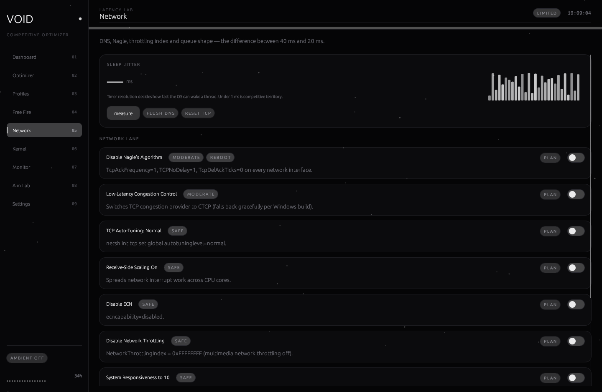
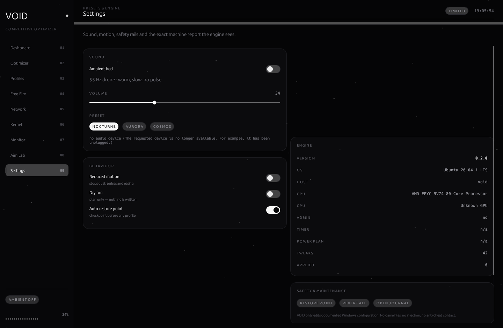

<div align="center">

# V O I D

**A luxury-grade competitive gaming optimizer.**
A native desktop app — one window, drawn on the GPU. Engine in-process, every lever documented, every change reversible.

`v0.2.0` · native UI · Windows tweaks · Free Fire / FF Max tuned · monochrome · ambient audio

[](https://github.com/husainprime20/VOID-OPTIMIZER/actions/workflows/build.yml)
[](https://github.com/husainprime20/VOID-OPTIMIZER/releases/latest)

</div>

---

## Download

**[⬇ VOID.exe — latest](https://github.com/husainprime20/VOID-OPTIMIZER/releases/latest/download/VOID.exe)** · Windows 10/11 x64
&nbsp;·&nbsp; [portable zip with `void-cli.exe` + checksums](https://github.com/husainprime20/VOID-OPTIMIZER/releases/latest)

```
1. download VOID.exe
2. double-click it          → Windows asks for Administrator once (the tweaks need it)
3. the window opens         → press IGNITE, or open Profiles and engage one
```

* **No console window.** The binary is built for the Windows GUI subsystem and every helper
  process is spawned with `CREATE_NO_WINDOW`, so nothing black flashes behind the app.
* **No browser, no webview, no localhost.** The UI is drawn by `egui` (OpenGL 3.3) inside the
  same process as the engine. There is no HTTP bridge, which means the old
  *"engine offline — could not reach the VOID engine API"* state is **structurally impossible**.
* Static CRT — no Visual C++ redistributable.
* Not code-signed: SmartScreen asks once → **More info** → **Run anyway**.
* Every release is compiled *and executed* by GitHub Actions on `windows-latest`
  (`--version`, full catalog dump, `VOID.exe --selftest`) before publishing.

---

---

## Screenshots

Rendered from the real binary, head-lessly, by CI on every push (`docs/shots/`):

| | |
|---|---|
|  |  |
|  |  |
|  |  |
|  |  |

## What VOID is

VOID is a **desktop performance toolkit for people who care about the last 3 milliseconds**.
It modifies *Windows* — power, kernel timers, scheduler bias, GPU frame path, TCP latency,
input stack — through the official `powercfg` / `bcdedit` / `reg` / `netsh` / `sc` / `fsutil`
interfaces, and it shows you exactly which command it will run *before* it runs it.

It does **not** touch game files, game memory, or anti-cheat. It never injects, never hooks,
never patches a running game. Everything it changes is a documented Windows setting with a
documented way back.

---

## Nine views

| view | what it does |
|---|---|
| **01 Dashboard** | catalog coverage ring, CPU/RAM sparklines, applied stack, live journal, quick actions |
| **02 Optimizer** | all 42 tweaks, searchable, filterable by lane and risk; every entry shows its exact plan |
| **03 Profiles** | 7 curated loadouts (competitive, free fire, latency, gpu, kernel, stream, bench) |
| **04 Free Fire** | detects BlueStacks / LDPlayer / MuMu / MEmu / Nox / GameLoop, launches and boosts them |
| **05 Network** | Nagle off, MMCSS Games task, throttling index, DNS flush, queue-shape sketch |
| **06 Kernel** | timer resolution, TSC sync, HAGS, `Win32PrioritySeparation`, VBS, core parking |
| **07 Monitor** | 1-second telemetry, sleep-jitter benchmark (avg/p50/p95/max/score + delta vs previous run), process list with boost |
| **01 Dashboard** | also: **game watch** — recognises running games from the process table and offers the matching loadout |
| **08 Aim Lab** | eDPI + cm/360° calculator, per-game sensitivity equivalents, warm-up ladder |
| **09 Settings** | sound, motion, safety rails, live engine report (CPU, GPU, admin, timer, power plan) |

### New in 0.2.0

* **Native window.** The whole UI was re-implemented in Rust on `egui` — no HTML, no CSS,
  no HTTP server, no Chromium runtime.
* **No terminal.** GUI subsystem + `CREATE_NO_WINDOW` on every child process.
* **Real ambient audio.** The busy WebAudio loop is gone. `src/audio.rs` synthesises a
  drone: 55 Hz floor, two detuned fifths that beat at ~2 mHz, filtered air, and one soft
  bell every ~11 s. Three presets — *Nocturne*, *Aurora*, *Cosmos* — with a volume slider.
* **Applied stack persists.** Reopen the app and it still knows what it changed.
* **Dry run is honest.** In dry-run, a tweak is logged and shown but never marked applied.
* **New:** process boost, emulator detection + one-click boost, jitter panel, eDPI lab,
  restore point from any view.

---

## Build from source (Windows)

```bat
:: 1. install Rust (one command, no admin) — https://rustup.rs
:: 2. build
build.bat
:: 3. run
VOID.exe
```

or by hand:

```bat
cargo build --release
target\release\void.exe
```

The first build downloads the UI + audio crates (roughly 3–4 minutes); after that everything
is offline. Linux/macOS builds fine too, in simulation mode: the UI is identical, tweaks are
logged instead of executed.

---

## Console companion (optional)

`void-cli.exe` is the scriptable half, for people who live in a terminal:

```
void-cli status [--json]          machine + engine state
void-cli catalog                  the tweak catalog as JSON
void-cli apply <id> [--dry-run]   apply a profile or one tweak
void-cli revert [--dry-run]       revert everything VOID applied
void-cli bench                    sleep-jitter benchmark (JSON)
void-cli app                      launch VOID.exe
void-cli serve                    legacy web preview on 127.0.0.1 (for design work)
```

---

## Safety model

* Nothing runs until you press something, and the plan is printed before it runs.
* **Dry run** (Settings, or Dashboard chip) logs commands without executing them.
* **Auto restore point** creates a Windows checkpoint before any profile is applied.
* **Revert all** restores every value VOID touched — the same switch that applies a tweak reverts it.
* Journal on disk: `%APPDATA%\VOID\void.log`. Settings: `%APPDATA%\VOID\settings.conf`.
* A crash writes `%APPDATA%\VOID\crash.log` and shows a dialog — it never disappears silently.

---

## Layout of the source

```
src/
  gui.rs              native entry point — GUI subsystem, one-time elevation, selftest
  cli.rs              console companion (also serves the legacy web preview)
  app.rs              shell: rail, topbar, routing, toasts, modals, animation clock
  theme.rs            the whole design system: palette, type scale, cards, toggles, rings
  views/
    mod.rs            dispatch, shared tweak row, dashboard, settings
    catalog_views.rs  optimizer, profiles, network, kernel
    live.rs           free fire, monitor, aim lab
  audio.rs            synthesised ambient bed (rodio, zero samples shipped)
  engine/
    mod.rs            state, apply/revert, telemetry, benchmark, emulator + process control
    catalog.rs        42 tweaks, 9 lanes, 7 profiles — every action documented & reversible
  platform.rs         process exec (no console), elevation, timer resolution, tasklist, UAC
  http.rs             legacy preview server (only used by `void-cli serve`)
assets/ui/            legacy web preview — kept for design comparison, not shipped in the app
tools/preview.py      dev mirror of the legacy preview (used while designing the native UI)
```

---

## License

MIT. Use it, fork it, ship it. No telemetry, no accounts, no network calls at runtime.
